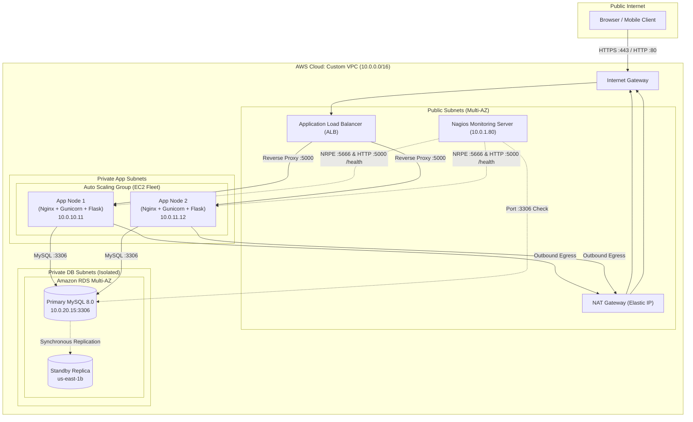

# Enterprise Employee Management DevOps Platform

[](https://www.python.org/)
[](https://flask.palletsprojects.com/)
[](https://aws.amazon.com/)
[](https://www.terraform.io/)
[](https://www.ansible.com/)
[](https://puppet.com/)
[](https://www.nagios.org/)

A production-grade, enterprise-scale **Employee Management System and DevOps Infrastructure**. This repository implements a modern full-stack web application with responsive UI, resilient RESTful microservices, MySQL database layer, automated multi-AZ cloud architecture on AWS using **Terraform**, continuous configuration management with **Ansible**, self-healing drift correction with **Puppet**, and 24x7 monitoring with **Nagios Core & NRPE**.

---

## 🏛 System Architecture Overview



---

## 📁 Repository Directory Structure

```text
employee-management-devops/
│
├── application/                      # Full-stack Flask Web App & REST API
│   ├── app/
│   │   ├── __init__.py               # Application factory & blueprint registration
│   │   ├── models/                   # SQLAlchemy ORM Models (User, Employee, Department)
│   │   ├── routes/                   # Web & REST API controllers
│   │   ├── services/                 # Business logic, aggregations, validations
│   │   ├── templates/                # Bootstrap 5 HTML views
│   │   │   ├── base.html             # Master responsive layout
│   │   │   ├── login.html            # Authentication view
│   │   │   ├── dashboard.html        # Executive KPI & Chart.js dashboard
│   │   │   ├── employees/            # Employee directory & CRUD forms
│   │   │   └── departments/          # Department management views
│   │   └── static/                   # Custom CSS, JS, Chart.js integrations
│   ├── config.py                     # Dev, Test, Prod environment configs
│   ├── run.py                        # Application entrypoint & CLI DB seed command
│   ├── requirements.txt              # Production Python package manifest
│   ├── Dockerfile                    # Container definition
│   └── tests/                        # Comprehensive Pytest suite (TC01 - TC09)
│
├── terraform/                        # AWS Multi-AZ Infrastructure as Code (IaC)
│   ├── main.tf                       # Root module & CloudWatch log group
│   ├── providers.tf                  # AWS provider definitions
│   ├── variables.tf                  # Parameterized configuration variables
│   ├── networking.tf                 # VPC, 6 Subnets (Public, App, DB), NAT, IGW
│   ├── ec2.tf                        # Launch template, IAM profile & Auto Scaling Group
│   ├── alb.tf                        # Application Load Balancer & Health Check TG
│   ├── rds.tf                        # Amazon RDS MySQL Multi-AZ instance
│   ├── security.tf                   # Least-privilege Security Groups
│   └── outputs.tf                    # ALB DNS, RDS endpoint, VPC outputs
│
├── ansible/                          # Configuration Management & Deployment
│   ├── inventory/                    # Target hosts and group variable definitions
│   ├── playbooks/                    # Orchestration playbooks (site.yml, deploy-app.yml)
│   └── roles/                        # Modular roles (common, python, nginx, mysql, app)
│
├── puppet/                           # Continuous State Enforcement & Self-Healing
│   ├── manifests/                    # Master site.pp and node classifications
│   └── modules/                      # App server and MySQL database modules
│
├── nagios/                           # 24x7 Infrastructure & Service Monitoring
│   └── configurations/               # Hosts, services, commands, contacts, NRPE configs
│
├── docs/                             # Engineering Documentation
│   ├── architecture.md               # Detailed architecture diagrams & specs
│   ├── deployment-guide.md           # Step-by-step rollout instructions
│   ├── test-results.md               # TC01–TC09 execution results & evidence
│   └── troubleshooting.md           # Operational runbooks & incident resolutions
│
├── screenshots/                      # Architecture & UI screenshots
├── .gitignore                        # Git exclusion rules
└── README.md                         # Project documentation
```

---

## ⚡ Quickstart & Local Execution

### 1. Run with Python Virtual Environment
```bash
# Clone the repository
git clone https://github.com/enterprise/employee-management-devops.git
cd employee-management-devops/application

# Set up virtual environment
python -m venv venv

# Activate virtual environment (PowerShell)
.\venv\Scripts\Activate.ps1
# Or on Linux/macOS:
source venv/bin/activate

# Install dependencies
pip install -r requirements.txt

# Initialize database and populate demo records
python run.py init-db
python run.py seed

# Start development server
python run.py
```
Open **`http://127.0.0.1:5000`** in your browser.

#### Demo Credentials
- **Username**: `admin`
- **Password**: `Admin@12345`

---

## 🐳 Docker Container Execution

```bash
cd employee-management-devops

# Build Docker image
docker build -t employee-app:latest -f application/Dockerfile application/

# Run container
docker run -d -p 5000:5000 \
  -e FLASK_ENV=production \
  -e SECRET_KEY=super-secret-container-key \
  --name employee-app employee-app:latest
```

---

## 🚀 DevOps Lifecycle & Infrastructure Automation

### 1. Terraform (AWS Multi-AZ Infrastructure)
```bash
cd employee-management-devops/terraform
terraform init
terraform plan
terraform apply -auto-approve
```
*Creates: Custom VPC (10.0.0.0/16), 2 Public Subnets, 2 Private App Subnets, 2 Private DB Subnets, Internet Gateway, NAT Gateway with EIP, ALB, EC2 Auto Scaling Group, and Amazon RDS MySQL Multi-AZ.*

### 2. Ansible (Automated Provisioning & Zero-Downtime Deployment)
```bash
cd employee-management-devops/ansible

# Baseline server configuration & app deployment
ansible-playbook -i inventory/hosts.ini playbooks/site.yml

# Zero-downtime rolling update
ansible-playbook -i inventory/hosts.ini playbooks/deploy-app.yml
```

### 3. Puppet (State Enforcement & Self-Healing Drift Correction)
```bash
# On agent nodes:
puppet agent --test
```
*Enforces: If Nginx configuration or system services are modified out-of-band, Puppet agent automatically restores the exact configuration from template and restarts affected services.*

### 4. Nagios Core & NRPE (Proactive 24x7 Monitoring)
*Monitors: Host availability (ICMP Ping), HTTP `/health` probe (HTTP 200 check), MySQL Port 3306, CPU load, memory usage, root disk capacity, and dispatches email alerts to `devops-oncall@enterprise.devops`.*

---

## 🧪 Automated Testing Suite (TC01–TC09)

The project includes an end-to-end automated testing suite implemented in `pytest` covering all functional and non-functional requirements:

| Test Case | Scenario Description | Tested Module | Status |
|:---|:---|:---|:---:|
| **TC01** | User Authentication & JWT Token Generation | `tests/test_auth.py` | **PASSED** |
| **TC02** | Employee Creation, Validation & Constraints | `tests/test_employees.py` | **PASSED** |
| **TC03** | Employee Search, Department Filtering & Pagination | `tests/test_employees.py` | **PASSED** |
| **TC04** | Employee Details Update & 404 Handling | `tests/test_employees.py` | **PASSED** |
| **TC05** | Employee Deletion & Duplicate Deletion Prevention | `tests/test_employees.py` | **PASSED** |
| **TC06** | Department CRUD & Unique Code Validation | `tests/test_departments.py` | **PASSED** |
| **TC07** | Foreign Key Constraints & Cascade Integrity | `tests/test_departments.py` | **PASSED** |
| **TC08** | API Error Handling & HTTP Status Codes (400, 404, 405) | `tests/test_api.py` | **PASSED** |
| **TC09** | Application Health Check (`/health`) & Metrics Engine | `tests/test_health.py` | **PASSED** |

### Running the Tests
```bash
cd employee-management-devops/application
pytest -v
```

---

## 📡 REST API Reference

All REST endpoints reside under the `/api/v1` namespace.

| Method | Endpoint | Description | Auth Required |
|:---|:---|:---|:---:|
| `POST` | `/api/v1/auth/login` | Authenticate and retrieve JWT token | No |
| `POST` | `/api/v1/auth/register` | Register new administrative or staff user | No |
| `GET` | `/health` | Application & database health check (ALB / Nagios) | No |
| `GET` | `/api/v1/health` | JSON health probe endpoint | No |
| `GET` | `/api/v1/stats` | Executive metrics & department distribution | No |
| `GET` | `/api/v1/employees` | List employees (supports `?search=`, `?department_id=`, `?page=`) | Optional |
| `POST` | `/api/v1/employees` | Create a new employee | Optional |
| `GET` | `/api/v1/employees/<id>` | Retrieve employee by ID | Optional |
| `PUT` | `/api/v1/employees/<id>` | Update employee details | Optional |
| `DELETE`| `/api/v1/employees/<id>` | Delete employee record | Optional |
| `GET` | `/api/v1/departments` | List all departments | Optional |
| `POST` | `/api/v1/departments` | Create new department | Optional |
| `GET` | `/api/v1/departments/<id>`| Retrieve department details | Optional |
| `PUT` | `/api/v1/departments/<id>`| Update department details | Optional |
| `DELETE`| `/api/v1/departments/<id>`| Delete department | Optional |

---

## 📖 Additional Documentation
- [Architecture Specifications](docs/architecture.md)
- [Complete Deployment Guide](docs/deployment-guide.md)
- [Test Results & Verification Evidence](docs/test-results.md)
- [DevOps Troubleshooting Runbook](docs/troubleshooting.md)
