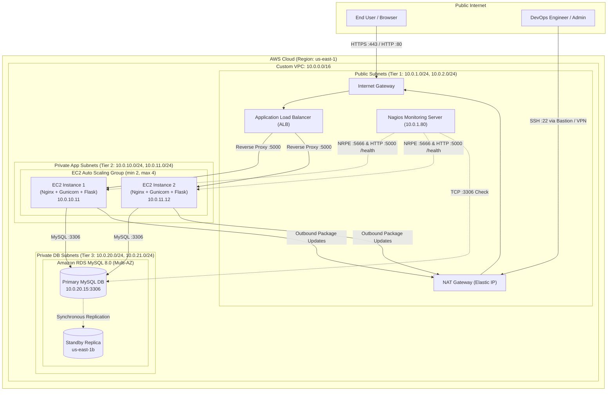
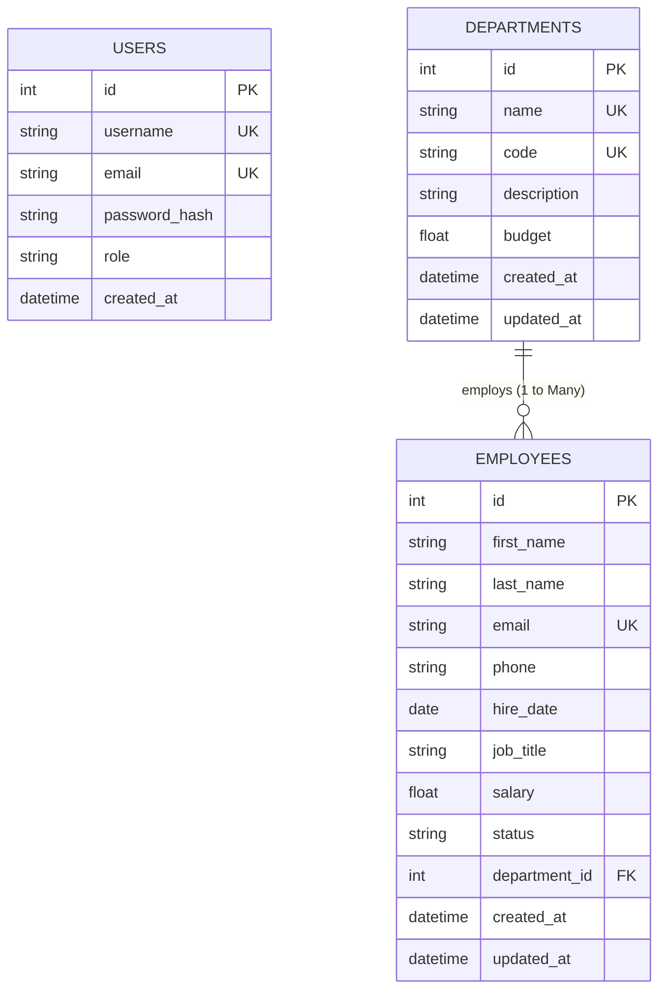

# Enterprise Employee Management DevOps Architecture

## 1. System Overview
The **Employee Management DevOps Platform** is designed for high availability, zero-downtime rolling deployments, strict security segmentation, and automated drift correction. It is deployed on AWS using **Terraform (IaC)**, provisioned with **Ansible**, continuously enforced by **Puppet**, and proactively monitored with **Nagios Core & NRPE**.

---

## 2. Infrastructure Architecture Diagram

---

## 3. Network Segmentation & CIDR Breakdown

| Subnet Tier | CIDR Block | Availability Zone | Purpose | Route Table Target |
|:---|:---|:---|:---|:---|
| **Public Subnet 1** | `10.0.1.0/24` | `us-east-1a` | ALB, NAT Gateway | Internet Gateway (`igw`) |
| **Public Subnet 2** | `10.0.2.0/24` | `us-east-1b` | ALB Multi-AZ | Internet Gateway (`igw`) |
| **Private App 1** | `10.0.10.0/24` | `us-east-1a` | EC2 App Node 1 | NAT Gateway (`nat-gw`) |
| **Private App 2** | `10.0.11.0/24` | `us-east-1b` | EC2 App Node 2 | NAT Gateway (`nat-gw`) |
| **Private DB 1** | `10.0.20.0/24` | `us-east-1a` | Primary RDS MySQL | Local VPC Only (Isolated) |
| **Private DB 2** | `10.0.21.0/24` | `us-east-1b` | Standby RDS MySQL | Local VPC Only (Isolated) |

---

## 4. Security Model & Defense in Depth

1. **ALB Security Group**:
   - Ingress: `80` and `443` open to `0.0.0.0/0`.
   - Egress: Forwarding to EC2 App instances on port `5000`.
2. **EC2 Application Security Group**:
   - Ingress: Port `5000` is **only** reachable from the ALB Security Group ID. No direct public internet traffic reaches application instances.
   - Ingress: Port `22` (SSH) is locked down to authorized admin/bastion CIDRs (`var.admin_cidr`).
   - Egress: Outbound traffic routed via the NAT Gateway for OS patches and PyPI updates.
3. **RDS Database Security Group**:
   - Ingress: Port `3306` allowed **only** from the EC2 Application Security Group ID.
   - Egress: Restricted to VPC local CIDR.

---

## 5. Entity Relationship (ER) Data Model

